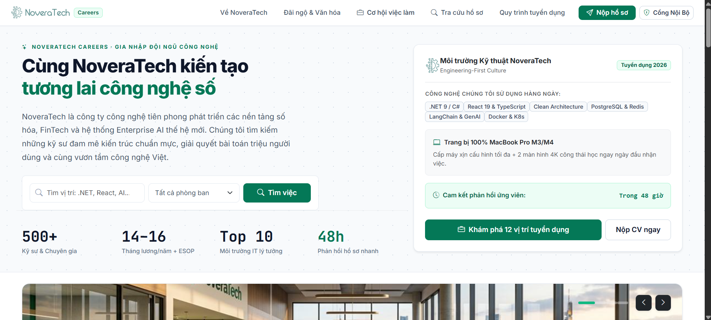
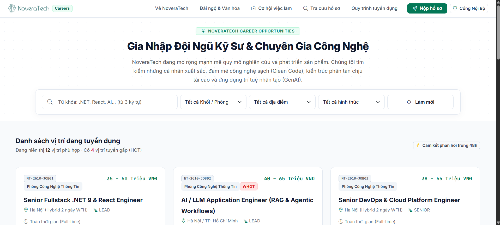
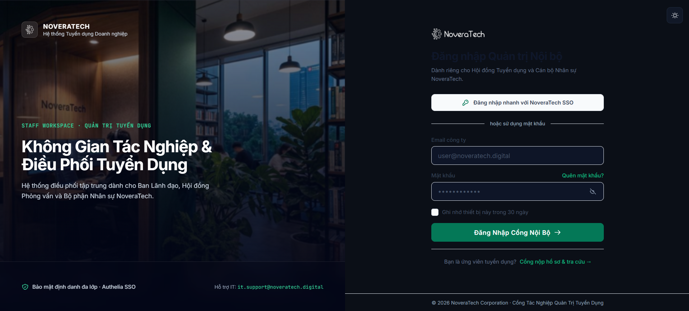
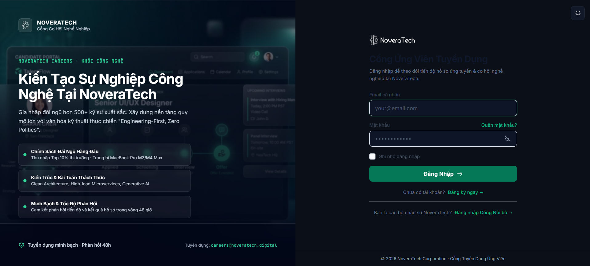

# 🏢 NoveraTech ATS — Hệ Thống Tuyển Dụng Doanh Nghiệp & Quản Lý Ứng Viên

[](https://dotnet.microsoft.com/)
[](https://www.postgresql.org/)
[](https://www.docker.com/)
[](LICENSE)

> **Hệ thống Tuyển Dụng Nội Bộ NoveraTech (Applicant Tracking System - ATS)** là nền tảng quản trị quy trình tuyển dụng toàn diện, tự động hóa từ khâu thu hút ứng viên, tiếp nhận hồ sơ, đánh giá phỏng vấn đa vòng, phân cấp phê duyệt offer lương, đến chuyển đổi thành nhân sự chính thức.

🔗 **Tên miền hệ thống:** [https://tuyendung.noveratech.digital](https://tuyendung.noveratech.digital)  
💻 **Mã nguồn dự án:** [https://github.com/kaedee206/hethongtuyendungnoibo](https://github.com/kaedee206/hethongtuyendungnoibo)

---

## 📸 Giao Diện Hệ Thống (UI Showcase)

### 📑 Bảng Tổng Quan Hình Ảnh

| STT | Hình Ảnh | Phân Hệ | Chế Độ | Nội Dung Trưng Bày |
|:---:|:---|:---|:---:|:---|
| **01** | [`01_landing_careers_hero.png`](./screenshot/01_landing_careers_hero.png) | Cổng Cơ Hội Nghề Nghiệp | Light | Trang chủ tuyển dụng, giới thiệu văn hóa công nghệ, đãi ngộ và thanh tìm kiếm nhanh. |
| **02** | [`02_job_opportunities_list.png`](./screenshot/02_job_opportunities_list.png) | Cơ Hội Việc Làm | Light | Danh sách các vị trí tuyển dụng đang mở kèm bộ lọc phòng ban, địa điểm và mức lương. |
| **03** | [`03_staff_login_portal_dark.png`](./screenshot/03_staff_login_portal_dark.png) | Quản Trị Nội Bộ | Dark | Cổng tác nghiệp Hội đồng Tuyển dụng & HR tích hợp NoveraTech SSO và bảo mật Authelia. |
| **04** | [`04_candidate_auth_portal_dark.png`](./screenshot/04_candidate_auth_portal_dark.png) | Cổng Ứng Viên | Dark | Đăng nhập/Đăng ký tài khoản ứng viên nộp hồ sơ, tra cứu tiến độ xét duyệt trực tiếp. |

---

### 1. Cổng Thông Tin Tuyển Dụng Công Khai (Public Careers Portal)

#### 1.1. Trang Chủ & Giới Thiệu Văn Hóa NoveraTech (`/`)
Giao diện chào đón ứng viên công nghệ với phong cách tối giản, hiển thị các cam kết đãi ngộ (14-16 tháng lương, Mac Pro M3/M4 Max), cam kết phản hồi hồ sơ trong 48h và thanh tìm kiếm vị trí trực quan.



#### 1.2. Danh Sách Vị Trí Đang Tuyển Dụng (`/#positions-list`)
Hệ thống hiển thị danh sách các vị trí đang tuyển (.NET 9, AI/LLM, DevOps, FinTech), hỗ trợ bộ lọc linh hoạt theo phòng ban, hình thức làm việc (Hybrid / Onsite) và dải lương minh bạch.



---

### 2. Cổng Xác Thực Doanh Nghiệp & Ứng Viên (Enterprise Authentication)

#### 2.1. Đăng Nhập Quản Trị Nội Bộ (`/Account/StaffLogin`)
Khu vực tác nghiệp tập trung dành cho Ban Lãnh đạo, Trưởng bộ phận chuyên môn (Hiring Manager) và Chuyên viên Tuyển dụng (Recruiter). Thiết kế 2 cột chuẩn Enterprise Dark Mode, loại bỏ các chi tiết thừa, tích hợp NoveraTech Single Sign-On (SSO).



#### 2.2. Đăng Nhập & Đăng Ký Cổng Ứng Viên (`/Account/CandidateAuth`)
Không gian dành riêng cho ứng viên nộp hồ sơ trực tuyến, theo dõi tiến độ qua từng vòng đánh giá và xác thực qua email OTP.



---

## 🚀 Tính Năng Cốt Lõi (Key Features)

- 🎯 **Cổng Ứng Viên Trực Tuyến:** Ứng tuyển nhanh, upload CV thông minh (trích xuất PDF tự động), theo dõi tiến độ thời gian thực.
- 📋 **Quản Lý Yêu Cầu Tuyển Dụng (Requisitions):** Khởi tạo phiếu đề xuất, kiểm soát ngân sách lương theo phòng ban, phê duyệt đa cấp.
- 🗂️ **Pipeline Tuyển Dụng Kanban:** Kéo thả hồ sơ ứng viên qua các giai đoạn (Ứng tuyển, Sơ loại, Phỏng vấn, Đề xuất Offer, Trúng tuyển, Nhận việc).
- 🤝 **Hội Đồng Phỏng Vấn & Đánh Giá Đa Vòng:** Xếp lịch phỏng vấn tự động, gửi email thông báo, chấm điểm ứng viên theo Khung năng lực chuẩn hóa.
- 💼 **Phê Duyệt Offer & Xuất Thư Mời Nhận Việc:** Kiểm soát hạn mức lương tự động phân luồng (Trưởng phòng duyệt / Ban Giám đốc duyệt), tạo thư mời nhận việc chuẩn thương hiệu.
- 📊 **Dashboard & Báo Cáo Tuyển Dụng:** Đo lường chỉ số chuyển đổi, SLA từng giai đoạn tuyển dụng và tiến độ thực tế theo thời gian thực.
- 🔐 **Bảo Mật Phân Quyền (RBAC & SSO):** Phân quyền 7 cấp độ theo vai trò, tích hợp Single Sign-On qua Authelia và Google OAuth 2.0.

---

## 🛠️ Ngăn Xếp Công Nghệ (Technology Stack)

| Thành phần | Công nghệ sử dụng |
|---|---|
| **Backend Core** | .NET 9.0, C# 13, ASP.NET Core MVC |
| **ORM & Data** | Entity Framework Core 9.0, Npgsql |
| **Database** | PostgreSQL 16 Alpine, Redis Cache |
| **Frontend & UI** | CSS Custom Properties (Design Tokens), Bootstrap 5, Bootstrap Icons, Vanilla JS |
| **Security & Auth** | Authelia (SSO / OIDC), BCrypt.Net, ASP.NET Core Identity Cookies |
| **Container & CI/CD**| Docker, Docker Compose, Nginx Reverse Proxy, GitHub Actions |

---

## ⚡ Hướng Dẫn Cài Đặt & Khởi Chạy Nhanh

### 1. Yêu cầu môi trường
- [.NET 9.0 SDK](https://dotnet.microsoft.com/download/dotnet/9.0)
- [Docker & Docker Desktop](https://www.docker.com/products/docker-desktop/)
- [PostgreSQL 16+](https://www.postgresql.org/) (nếu chạy local không qua Docker)

### 2. Khởi chạy toàn bộ hệ thống bằng Docker Compose (Khuyên Dùng)

```bash
# Di chuyển vào thư mục dev
cd dev

# Khởi chạy toàn bộ các dịch vụ (Web, Postgres, Nginx)
docker compose up -d --build

# Kiểm tra trạng thái các container
docker compose ps
```

Sau khi khởi chạy thành công:
- **Cổng Tuyển Dụng & Ứng Viên:** [http://localhost](http://localhost) (hoặc [http://localhost:8085](http://localhost:8085))
- **Cổng Quản Trị Nội Bộ:** [http://localhost/Account/StaffLogin](http://localhost/Account/StaffLogin)

---

## 👥 Nhóm Thực Hiện
- **Dự án:** Hệ thống Tuyển Dụng Nội Bộ NoveraTech
- **Nhóm:** Novera Tech Team
- **Hỗ trợ kỹ thuật:** `it.support@noveratech.digital`
