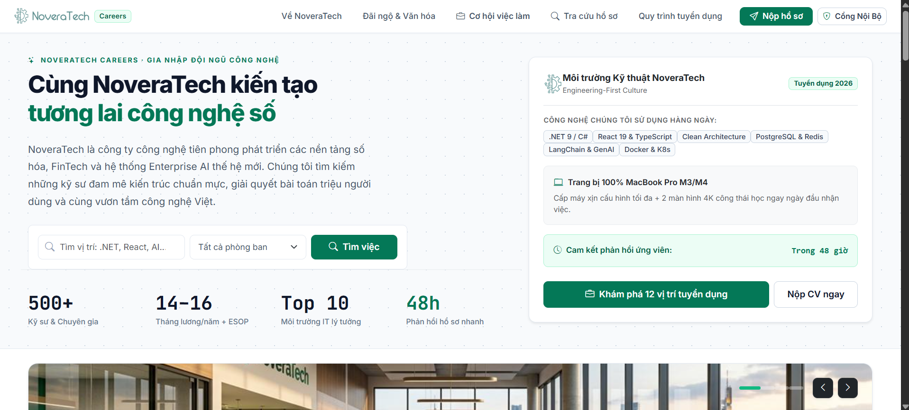
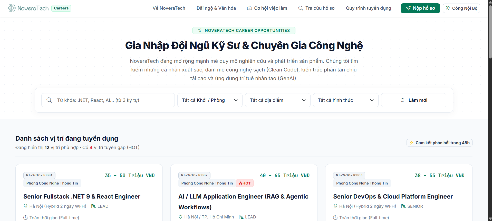
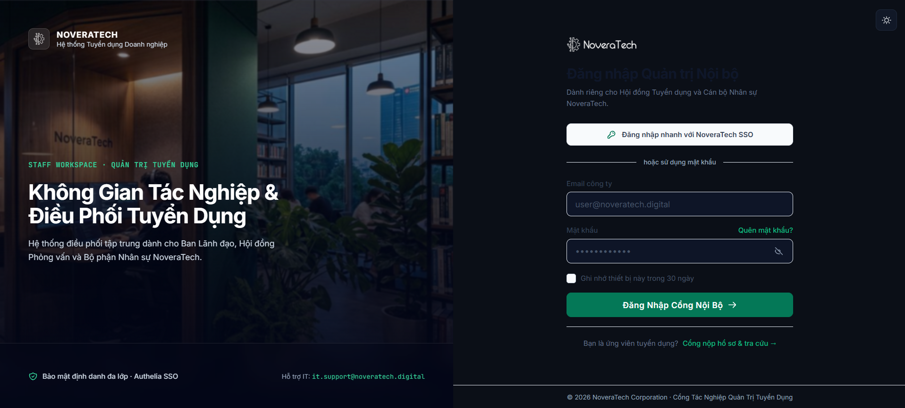
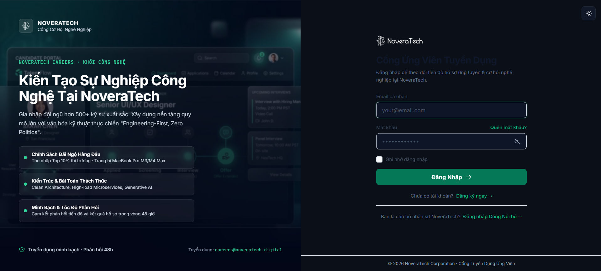

# 📸 NoveraTech ATS — Thư Viện Ảnh Giao Diện Hệ Thống (UI Showcase)

> **Dự án:** Hệ thống Tuyển Dụng Nội Bộ & Quản Lý Ứng Viên (Applicant Tracking System - ATS)  
> **Tổ chức:** NoveraTech Corporation  
> **Website chính thức:** [https://tuyendung.noveratech.digital](https://tuyendung.noveratech.digital)  
> **Phiên bản giao diện:** Enterprise UI v4 (Tối ưu trải nghiệm thực chiến, chuẩn hóa tương phản và loại bỏ hoàn toàn chi tiết thừa)

---

## 📑 Danh Mục Ảnh Giao Diện

| STT | Tên Tệp Tin | Phân Hệ | Chế Độ (Theme) | Mô Tả Chức Năng |
|:---:|:---|:---|:---:|:---|
| **01** | [`01_landing_careers_hero.png`](./01_landing_careers_hero.png) | Cổng thông tin Tuyển dụng | Sáng (Light) | Banner trang chủ, giới thiệu văn hóa công nghệ, đãi ngộ và công cụ tìm kiếm vị trí nhanh. |
| **02** | [`02_job_opportunities_list.png`](./02_job_opportunities_list.png) | Cơ hội việc làm | Sáng (Light) | Bộ lọc tìm kiếm tin tuyển dụng đa tiêu chí theo khối phòng ban, địa điểm và danh sách thẻ việc làm nổi bật. |
| **03** | [`03_staff_login_portal_dark.png`](./03_staff_login_portal_dark.png) | Quản trị Nội bộ | Tối (Dark) | Đăng nhập phân hệ tác nghiệp Hội đồng Tuyển dụng & Nhân sự tích hợp NoveraTech ID SSO và xác thực đa lớp Authelia. |
| **04** | [`04_candidate_auth_portal_dark.png`](./04_candidate_auth_portal_dark.png) | Cổng Ứng viên | Tối (Dark) | Đăng nhập và đăng ký tài khoản ứng viên nộp hồ sơ, tra cứu tiến độ xét duyệt trực tiếp. |

---

## 1. Cổng Thông Tin Tuyển Dụng Công Khai (Public Careers Portal)

### 1.1. Trang Chủ & Văn Hóa Doanh Nghiệp (`/`)
Giao diện chào đón ứng viên công nghệ với phong cách tối giản, hiển thị các cam kết đãi ngộ (14-16 tháng lương, Mac Pro M3/M4 Max), cam kết phản hồi hồ sơ trong 48h và thanh tìm kiếm vị trí trực quan.

---

### 1.2. Danh Sách Vị Trí Tuyển Dụng Đang Mở (`/#positions-list`)
Hệ thống hiển thị danh sách các vị trí đang tuyển (Engineering, AI/LLM, DevOps, FinTech), hỗ trợ lọc linh hoạt theo phòng ban, hình thức làm việc (Hybrid / Onsite) và mức lương công khai minh bạch.

---

## 2. Cổng Xác Thực Doanh Nghiệp & Ứng Viên (Enterprise Authentication)

### 2.1. Đăng Nhập Quản Trị Nội Bộ (`/Account/StaffLogin`)
Khu vực tác nghiệp tập trung dành cho Ban Lãnh đạo, Trưởng bộ phận chuyên môn và Chuyên viên Tuyển dụng (Recruiter). Thiết kế 2 cột chuẩn Enterprise Dark Mode, loại bỏ các chi tiết thừa, tích hợp NoveraTech Single Sign-On (SSO).

---

### 2.2. Đăng Nhập & Đăng Ký Cổng Ứng Viên (`/Account/CandidateAuth`)
Không gian dành riêng cho ứng viên nộp CV, theo dõi trạng thái hồ sơ qua từng vòng đánh giá và nhận thư mời phỏng vấn / tuyển dụng.

---

## 🛠️ Công Nghệ Nền Tảng (Tech Stack)
- **Backend:** .NET 9, ASP.NET Core MVC, Entity Framework Core 9
- **Database & Cache:** PostgreSQL 16 Alpine, Redis
- **Security & SSO:** Authelia Identity Provider, OpenID Connect, BCrypt
- **Frontend & Design System:** Modern CSS Variables (Semantic Tokens), Bootstrap 5, SVG Icons, Responsive Design & Dark Mode
- **DevOps:** Docker, Docker Compose, Nginx Reverse Proxy, GitHub Actions CI/CD
